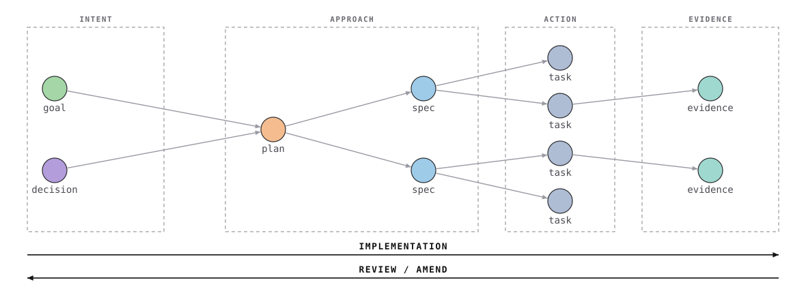
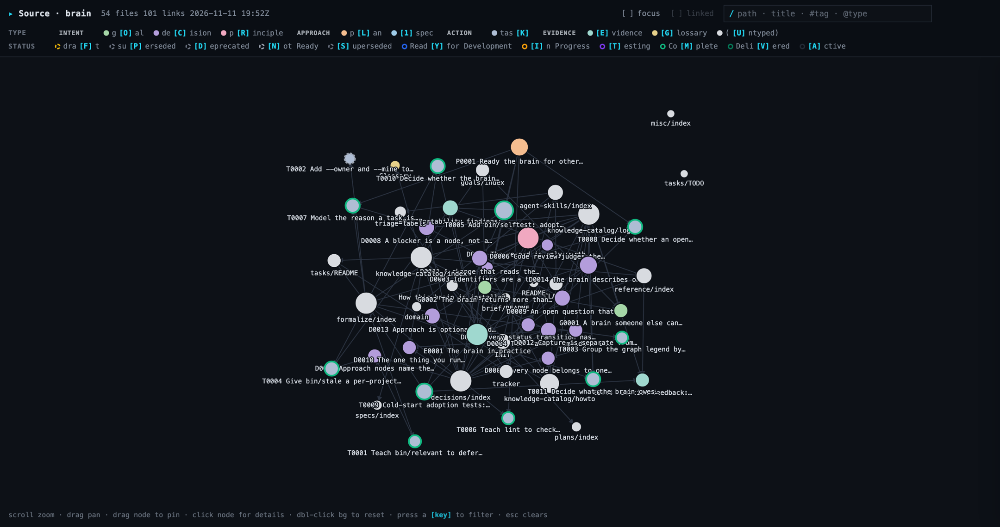

# brain

A codebase records what you built. It does not record why you built it that
way, and the why is the first thing you lose.

This brain project is intended to be the other half: the goals, the decisions,
the plans, the tracker and what you learned afterwards, as linked Markdown with
YAML frontmatter, in Google's
[Open Knowledge Format](https://github.com/GoogleCloudPlatform/knowledge-catalog/tree/main/okf).

There is no database and no service, so the files are the ground truth. That
makes everything in the brain equally legible to a person and to an agent. The
brain is also fully portable, because it is built on open standards: Git and
linked Markdown.

The project also ships a set of skills that use the brain as their backing
store, so your agent can settle a decision, cut a feature into work, or check
what shipped against what you meant to build. From an interface perspective
they look a lot like
[Matt Pocock's agent skills](https://github.com/mattpocock/skills), and several
share their names outright, `/to-spec`, `/implement`, `/wayfinder` and
`/code-review` among them. That is intentional. This project was heavily inspired by agent skills, but wanted to provide a different backing store than GitHub Issues, etc. In fact, if you're using Matt Pocock's agent skills already, you can likely point your agent at this repo and have it modify your existing agent skills to support a brain as a backing store, though I haven't tried this.

## The four categories

Brain builds a directed knowledge graph out of typed nodes, and every node sits in
exactly one of four categories that run left to right in a directed fashion.

<picture>
  <source media="(prefers-color-scheme: dark)" srcset="docs/lineage-dark.svg">
  
</picture>

- **Intent** holds `goal`, `decision` and `principle` nodes, which are what
  you're trying to do and what you've settled.
- **Approach** *(optional)* holds `plan` and `spec` nodes, which are how you
  intend to deliver on a goal or a decision.
- **Action** holds `task` nodes, which are what gets done.
- **Evidence** holds `evidence` nodes, which are the observations and what you
  learned from carrying the actions out.

The benefit of this approach is that work is directed (in the graph theory sense) from intent to approach
to action to evidence, and can be measured the whole way. Reviewing your work
is the same process run backwards, from the evidence and the action back to the
intent, to make sure that what you did actually met the goal you set out to
accomplish.

Nodes carry an id and will be referenced directly by your coding agent. Each is a type letter and four digits, flat and global. `G` goal (e.g., `G0002`),
`D` decision *and* principle, `P` plan, `S` spec, `T` task, `E` evidence.

## Installing the brain

Paste this into the coding agent working on your project:

> read https://raw.githubusercontent.com/hootener/brain/main/INIT.md and follow it

That is the whole install. The agent asks you where the brain should live,
fetches the files, runs `bin/adopt`, and then fills the brain with your
project. 

`bin/adopt` **installs**. It links the brain's skills so Claude Code can use them, initializes the brain, etc.

`INIT.md` **fills** the brain. It reads your repository, imports the ADRs and glossary you already have, mines
the Claude transcript history for decisions nobody wrote down, and asks for the
first goal. They stay separate because one job is mechanical and one needs
judgment, see:
([the placement and install decision](knowledge-catalog/decisions/D0004-placement-and-install.md)).

**Fork it first if you mean to keep your own copy.** From time to time, I will update this brain as I think it needs improved. If you want to benefit from those improvements, fork this repo. When installing, point the prompt at your
fork's raw URL instead of this repo. Later, if you want to update, you can pull upstream changed into your fork, and run `bin/update`.

### Install Methods: Picking embedded or sibling

There are two ways to install the brain in your project. Embedded: the `brain` folder lives directly in your repo, and its changes are committed alongside commits on the project. Sibling: the `brain` folder is committed _beside_ you repo and you manage commits, etc into the brain separately. In truth your coding agent is managing those commits, so the day-to-day work will feel functionally identical to you. As a rule of thumb, use embedded for projects where you don't mind the decision making riding along with the project (like this repo). Use sibling every other time: when working in a repo you don't fully control, a repo where you don't want the decision making shipping along with the code, or you want the `brain` to track your knowledge separately and not the knowledge of your whole team. More on each approach below:

**Embedded (`<repo>/brain/`) is the default**, because versioning the record in
the same repository as the code is the only thing that makes "this decision was
true at this commit" checkable rather than asserted. The decision and the code
it governs move in one commit, and the reviewer meets the decision in the pull
request.

**Sibling** is fully supported and required in two cases you will hit. Either
you don't control the repository, as in client work, a shared company project
or an outside contribution, or one brain serves several repositories.

Sibling means a **workspace**: the brain and the project repositories side by
side in a plain folder, and you run Claude Code from the folder.

```
workspace/
├── .claude/skills -> ../brain/skills
├── brain/                  # its own git repo, hooks and CI live here
└── acme-api/               # the project. Never written to.
```

**Nothing is written into the project repositories.** Not `.claude/`, not
`.github/`, not `.git/hooks`. The repositories are recorded in `config.md`'s
`repos:` field and read. That is the entire reason to pick sibling, because a
shared repository stays clean and nobody else on it ever sees a file they
didn't ask for.

Sibling has one cost. **Start Claude Code in the workspace, not in the project
folder**, which is what keeps the project clean and what makes the `brain/...`
prefix every skill uses resolve. `bin/adopt` prints the instruction on the way
out.

### Updating the brain

The brain splits into the generic half (`bin/`, `skills/`, `hooks/`, `docs/`,
`.github/`, and the templates under
`knowledge-catalog/reference/agent-skills/`) and your half (the rest of
`knowledge-catalog/`, `tasks/`, `plans/`, `brief/`, `work/`, `config.md`,
`facts.md`). Upstream only ever changes the generic half.

To update:

```bash
brain/bin/update --from https://github.com/<you>/brain.git
brain/bin/update --list        # exactly what counts as generic
```

If you haven't forked, you can use this repo's url as the `--from` url. 

`bin/update` reports what changed by hashing the tree before and after itself,
rather than by listing what it meant to do. That report was wrong in both
directions for three releases, because three transforms run after the copy and
none of them appeared in the list.

## Getting started: /grill-change

The best way to start is with a proposal you want stress-tested, so reach for
`/grill-change` and try to build something new. It works the way the grill-me
prompts you have already seen do, asking you a lot of questions about what you
want to build, except that it leverage your brain to assist with the task. This skill will cite nodes in the brain that support or refute your proposal, and will use the brain to provide defaults to /grill-changes's questions.

Once the grill skill is finished, you can follow the skill path all the way to a built feature,
writing a plan and specs on the way when the work has a planning phase. At the
end, `/spec-review` traverses the brain backwards from what you built to the
intent that asked for it, so you can see whether what you built matches what
you meant to build. And `/interrogate` is there when you want to query the
brain directly rather than change anything.

### Day one, building something

Consider a simple goal: *the list page loads in under a second*
(`G0001`). To implement this goal, you want to cache a server-side permission lookup.

Start with the proposal rather than with the spec:

```
/grill-change
```

It reads the record before it argues, and every challenge it puts back to you
carries the path it came from, so you can check the objection rather than take
its word. What survives that is what you spec:

```
/to-spec
```

It asks the record first, resolves which goal this spec serves, and writes the
spec as `S0001` with `serves:` pointing at the goal. If no goal fits, it says
so and writes the goal rather than inventing one to fill the field. Where the
work has no planning phase, skip this step and let `/to-tasks` cut the work
straight from the decision it serves.

```
/to-tasks
```

That cuts the spec into vertical slices, each with its blocking edges, each
citing the decisions it carries out. The slices land in an **initiative**,
which is the folder that holds the tasks for one body of work and the name you
pass to most tools. Ask for the board:

> where are we on the caching initiative?

```console
task                                             status                 waits on  title
caching/T0001-cache-permission-lookups-for-th…   Ready for Development  -         Cache permission lookups for the life of a request
caching/T0002-invalidate-the-cache-when-a-per…   Ready for Development  T0001     Invalidate the cache when a permission changes

frontier (claimable now): caching/T0001-cache-permission-lookups-for-the-life.md
```

Then `/implement`, which reads the lineage before writing a line. You can ask
for the same walk yourself at any point:

> what asked for T0001, and is every claim upstream of it still true?

```console
Ancestry of T0001-cache-permission-lookups-for-the-life.md
  4 document(s) upstream

  terminates at: G0001 The list page loads in under a second

  ── ACTION ──────────────────────────────────────────────
     What did neighboring work establish that this depends on?

  T0001 Cache permission lookups for the life of a request
      brain/tasks/caching/T0001-cache-permission-lookups-for-the-life.md  · Ready for Development

  ── APPROACH ────────────────────────────────────────────
     Did we take the route we said, or did it widen without being argued?

  S0001 Cache the permission lookup
      brain/knowledge-catalog/specs/S0001-cache-the-permission-lookup.md  · active  · via spec
      promises: Permission lookups repeat many times within one request, so cache
                them for the life of that request.

  ── INTENT ──────────────────────────────────────────────
     Is every claim here still true, and does the change still serve it?

  D0001 Permissions come from the database, never from the session
      brain/knowledge-catalog/decisions/D0001-permissions-come-from-the-database.md  · active  · via link
      promises: Every permission decision is read from the permissions table. The
                session may carry a user id, never the rights it implies.
```

Notice that your agent is giving you justification (or contradiction) for what you want based on traversal and usage of the brain. This is the power of the brain: it uses your prior intents and actions to contextualize your current change and help you, the implementor, decide if the change is correct. 

The `terminates at:` line is one way the brain does this. It means the work has a recorded
intent to be checked against. If the line says `⚠ UNTERMINATED`, nothing
upstream explains why this is being built, which is a finding in and of itself.

Then `/spec-review`, which walks the same chain backwards, asks whether what
shipped still serves the intent, lists the upstream documents the build made
false, and moves the task to `Complete`.

### Three weeks later, where it pays back

Someone, possibly you and possibly an agent, proposes: *hold the cache in
process memory between requests, instead of rebuilding it on every one.*
Reasonable on its face, and it makes the thing you just shipped faster. Before
building it, ask:

> does the record already say anything about holding the cache in process
> memory between requests?

```console
Brain hits for: hold the cache in process memory between requests
  matched on: hold, cache, process, memory, between, requests

  [decision] Nothing is cached beyond the life of a request
      brain/knowledge-catalog/decisions/D0002-nothing-is-cached-beyond-the-request.md:27  · active
      “- **Hold the cache in process memory between requests** -- rejected: we run
        more than one instance, so each answers from its own copy, and the bug
        reaches a user as stale data at random.”
```

This is the exact proposal, already rejected, with the reason. A human or agent can read this and decide next steps accordingly.

You can also work from the code level:

> which decisions govern app/cache/RequestCache.php?

```console
  D0002  Nothing is cached beyond the life of a request
      brain/knowledge-catalog/decisions/D0002-nothing-is-cached-beyond-the-request.md
      must hold: No cache outlives the request that created it.
      matched:   app/cache/RequestCache.php

  A change that contradicts one of these needs a recorded exit:
  amend the decision, or proceed against it with the id in the
  task's `# Log`. Noting it and moving on is not one of them.
```

`/grill-change` puts that constraint to you with the path attached, so you can
check the claim rather than take its word. No you can decide whether to amend `D0002` on the record, or proceed against it with the id
logged so the next reader finds a deliberate exception instead of an accident.

That is the whole return on day one's bookkeeping, and it is why the first pass
feels like overhead and the second one doesn't.

### Checking an initiative is actually finished

> did we build everything G0001 asked for?

```console
  [task] T0001 Cache permission lookups for the life of a request  ← outstanding
  [task] T0002 Invalidate the cache when a permission changes  ← outstanding
  [spec] S0001 Cache the permission lookup
  [decision] D0001 Permissions come from the database, never from the session

  2 of these are not done. An intent is complete when nothing
  it asked for is outstanding — omission, not drift, and a green
  test suite will not show it.
```

A reverse walk finds **drift**, which is building something subtly different
from what was asked. Only the forward walk finds **omission**: the spec nobody
got to, the task left at `Not Ready` while the initiative was called done.
`/audit` runs both walks and asks you about whatever it can't judge on its own.

## CI

The brain ships several built-in checks you can wire into your CI, so that the
record stays correct across later commits and pull requests. This is opt-in,
but definitely worth considering. `bin/lint` and `bin/stale` are what keep the
record honest between reviews, and CI is the only place they run without
somebody remembering to run them.

It stays opt-in because `.github/` is your team's directory, so `bin/adopt`
describes the workflow and installs it only on `--with-ci`. The workflow
(`.github/workflows/brain.yml`) locates the brain itself, so one file works
embedded or sibling and needs no setup step.

| Step | Fails the build? |
|---|---|
| `bin/lint` | **yes** on errors. Warnings never fail, because an unresolved link is a valid marker of future work |
| `bin/stale` | **yes**, because a countable claim contradicting the repo is a false statement a reader will meet |
| `bin/doctor` | **yes**, because a broken install makes everything else meaningless |
| `bin/unread` | **yes**, because a field the record carries and no tool reads is inert without ever looking lost |
| graph is current | **yes**. `graph.html` is generated *and* committed, so it drifts silently |
| decisions in force | no, printed to the run summary on a PR |
| `bin/selftest` | **yes**, because a fresh install must be silent and the foreign-content fixture must behave as designed |
| `bin/reconcile` | no, because an ambiguous status is a question for a person |

> **Forking does not enable Actions.** GitHub disables workflows on a fork by
> default. Open the Actions tab once and confirm.

## Skills

Thirteen, grouped by where they sit on the picture above.

**Forward, implementation**

| | |
|---|---|
| `/grill-change` | Interrogates a proposal against what the record already decided, measured and got wrong. Every challenge cites a path, so the challenge is checkable rather than decision-shaped. |
| `/to-spec` | Turns the conversation into a spec. Resolves the goal the spec serves first, and if no goal fits, says so and writes the goal rather than inventing one. Optional, and four of five brains have never used it. |
| `/to-tasks` | Breaks a spec, a plan or the conversation into tracer-bullet tasks, each a vertical slice that works end to end, with their blocking edges. Each task names the decision it carries out, which is the edge that makes the intent layer reachable. |
| `/implement` | Builds it, after reading the lineage and the constraints. Claims the task, journals as it goes, hands off at `Testing`. |

**Back, review and amend**

| | |
|---|---|
| `/spec-review` | The reverse walk. Checks the change still serves its intent, walks *forward* to catch what the intent asked for and nobody built, and produces the list of upstream documents the build made false. Owns `Testing → Complete`. |
| `/audit` | Reconciles a subgraph's statuses against what the repository shows, batches what is unambiguous, and asks about the rest. Surfaces work done with no node at all. |

**Off the rails**

| | |
|---|---|
| `/interrogate` | The way *in*. Ask the brain a question and get an answer rather than a tour, whether you are an interviewer, a teammate, or yourself six weeks later. |
| `/triage` | Moves tasks through the triage states and writes agent-ready briefs. |
| `/wayfinder` | For work too big to plan in one session: a map of decision tickets, resolved one at a time until the route is clear. |
| `/research` | Investigates against primary sources and files the findings as evidence, after checking whether the brain already answers the question. |
| `/domain-modeling` | Sharpens the glossary and the domain model as you design. |
| `/code-review` | The artifact rather than the graph: correctness, security, performance and standards, as parallel sub-agents. Works in a repository with no brain. |
| `/handoff` | Builds a self-contained HTML page for whoever is picking the work up, composing what the graph knows with a hand-written walkthrough. Never required. |

## Tools

Throughout regular use of the brain you should not need to call these tools
yourself, because your coding agent will reach for them as it works, which is
what the prompts above are doing. They are here for the times you do want to
run one directly.

```bash
bin/adopt                      # install into a project
bin/doctor                     # is the install sound
bin/lint                       # the gate: taxonomy, ids, links, direction, frontmatter
bin/status [initiative]        # task table and the claimable frontier
bin/note "<what happened>"     # record it now, decide what it is later
bin/which                      # what kind of node is this (two questions)
bin/relevant "<change>"        # what the record already says about a proposal
bin/constraints <paths>        # which decisions govern these files
bin/ancestry <id> [--claims]   # walk back to the intent that asked for it
bin/ancestry <id> --forward    # walk on to what that intent asked for
bin/reconcile [initiative]     # task status against the repository
bin/new <type> "<title>"       # allocate an id and scaffold the node
bin/renumber <old> <new>       # the one sanctioned reason to change an id
bin/relink                     # backticked citations of nodes become real links
bin/handoff <init> --for <who> # a self-contained HTML page for someone outside
bin/stale                      # countable claims that no longer match the files
bin/unread                     # frontmatter the record carries that no tool reads
bin/index                      # rebuild every folder index from the nodes present
bin/utterances                 # what the operator said, from Claude Code's transcripts
bin/selftest                   # a fresh install, and a corpus not written for this brain
bin/prove <command...>         # does a tool's output match what it did to the files
bin/update                     # pull the generic half from upstream
bin/graph-build                # rebuild graph.html
bin/diagram                    # rebuild the four-categories picture
```

No dependencies anywhere, and every tool is stdlib Python 3.

## The graph

`bin/graph-build` writes `graph.html`, a browser-only force graph of every
Markdown file here. Nodes are files and edges are the links between them.



**Fill is the node's `type`, and the ring is its `status`.** Click a node for
its metadata and rendered contents.

The filter bar takes `#tag`, `@type`, `@status`, a category name such as
`@intent`, and plain text, all ANDed. Every legend entry is clickable and
carries a bracketed keyboard key. **Focus** removes non-matching nodes,
**linked** widens by one hop, and `Esc` clears.

## Layout

| Directory | Holds | Lifecycle |
|---|---|---|
| `knowledge-catalog/` | goals, decisions, specs, evidence, glossary | keep, supersede rather than delete |
| `plans/` | how things get built, when you plan | superseded by what shipped |
| `tasks/` | the tracker. One `task` file per ticket | churns |
| `work/` | per-worker journals, `<initiative>/<worker>.md` | kept while the initiative is open |
| `brief/` | source material the project answers, verbatim | fixed |
| `skills/` | the agent skills, symlinked into `.claude/skills` | generic, edit here |
| `bin/` | the tools above | generic |
| `example/` | after `bin/adopt`: this template's own record, as a worked example | delete when you don't need it |
| `docs/` | the diagrams and screenshots the README embeds | the lineage picture is rebuilt by `bin/diagram` |
| `hooks/` | the post-commit hook `bin/adopt` installs | generic, edit here |
| `feedback/` | raw inbound: transcripts, reports. **Not in git** | delete once the findings are written |

Fork it, run `bin/adopt`, and read `brain/INIT.md` in the same session.
